# CathLab Companion

[](https://github.com/Rakeshdharan/vla-cathlab-companion/actions/workflows/ci.yml)


A **simulation-first, self-improving robot learning loop**. A Franka Panda hands cathlab instruments to a clinician
("Hand me the {bottle | vial | syringe}"); evaluation failures are turned into targeted synthetic data and a
retrained policy, which is promoted only when it statistically beats production.

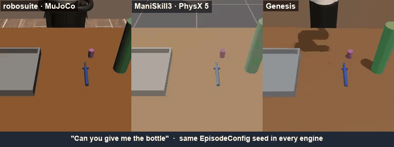

<sub>One `EpisodeConfig` seed, three physics engines: the scene, objects and expert are engine-agnostic
(`dataengine/`), so cross-physics generalisation can be measured cell by cell.</sub>

```
[Generate (robosuite / ManiSkill3 / Genesis)] → [Convert to LeRobot v3] → [Train] → [Evaluate]
       ▲                                                                              │
       └──── DataEngine ◄── Loop Controller (failures → next_run.json) ◄─────────────┘
                                                                     │
                                                                     ▼
                                               [Register → Promote → Serve → Rollout]
```

## Quick start

```bash
git clone https://github.com/Rakeshdharan/vla-cathlab-companion && cd vla-cathlab-companion
git config core.hooksPath .githooks   # strips AI co-author trailers from commits
make install && make test      # core env (uv) + GPU-free tests
make dev                       # Control Station: http://localhost:8700
make worker-robosuite          # robosuite worker :8711 (needs the robosuite conda env)
make demo-reset                # rebuild var/registry + the production failure report from committed eval reports
```

Full native/remote-GPU install: [docs/INSTALL.md](docs/INSTALL.md). `make lint` runs ruff (via `uvx`).

## Results

**Cross-physics eval** (suite_v2: 3 objects × 5 tiers × seeds 5000–5003, 60 episodes per cell, Wilson 95 % CI).
Rows are trained on one (or all) engines, columns evaluated in each engine.

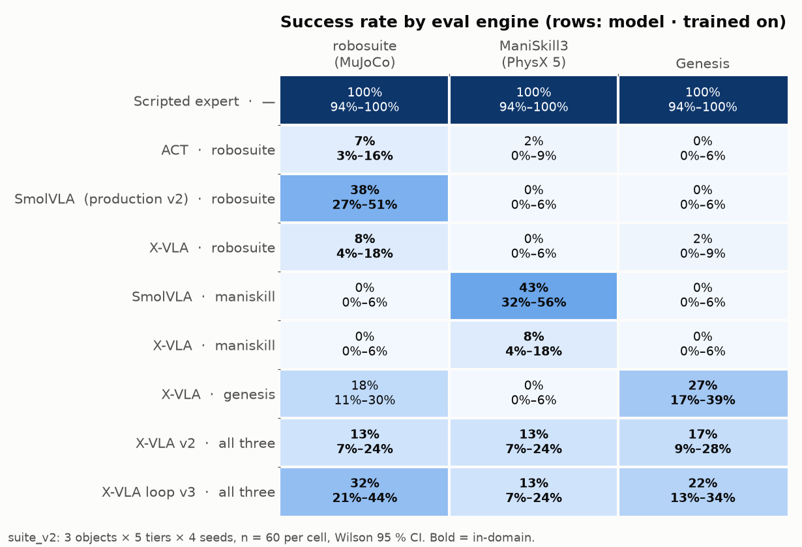

**Reading:** the cross-physics gap is symmetric and total — each policy works almost only in the engine it was
trained in (SmolVLA 38 % in robosuite / 0 % in ManiSkill when trained on robosuite, and 43 % in ManiSkill / 0 %
in robosuite when trained on ManiSkill). Training on all three engines (`xvla_panda_pick_v2`) closes most of the gap
at a lower absolute rate (13–17 %); one loop iteration with 48 targeted episodes (`xvla_panda_pick_v3`) lifts that to
32 / 13 / 22 %.

<p>
  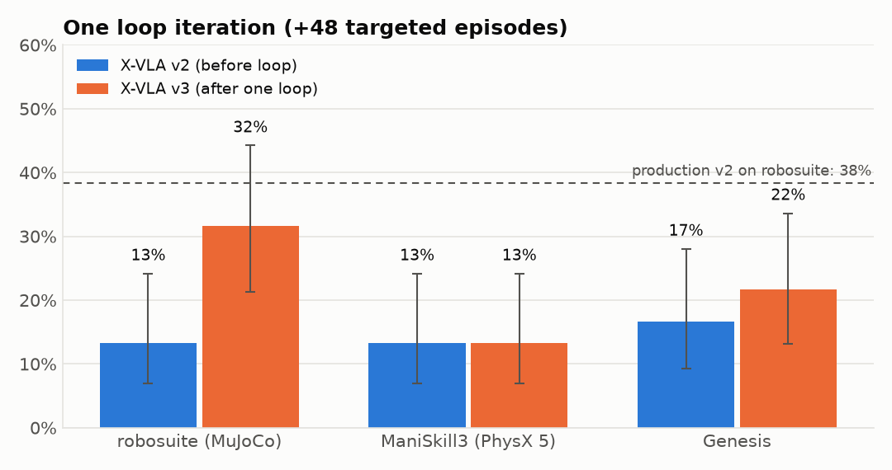
  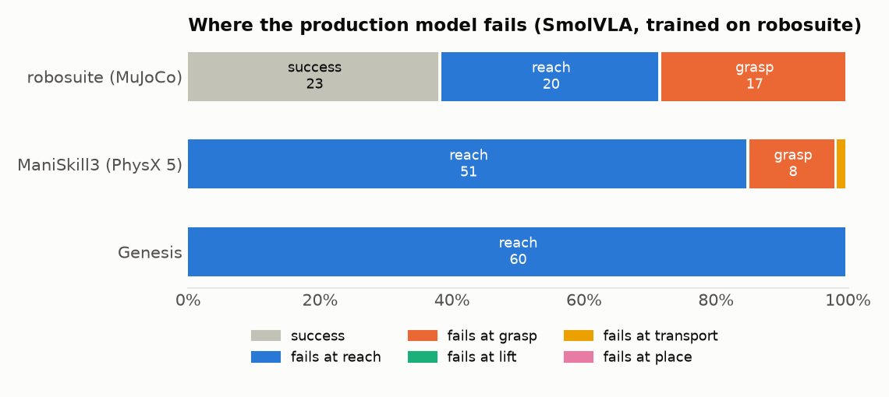
</p>

**Registry outcome:** production `cathlab-pick@v2` = SmolVLA (`smolvla_panda_pick_v1`), **38 % on robosuite**. The
loop retrain `xvla_panda_pick_v3` (32 % / 13 % / 22 % robosuite/ManiSkill/Genesis) was registered but **refused by
the promotion rule**: its CI low on the primary engine (21 %) does not beat production's 38 % (`configs/serve.yaml`).

<details>
<summary>Full table</summary>

| Model | Trained on | eval robosuite (MuJoCo) | eval ManiSkill (PhysX) | eval Genesis |
|---|---|---|---|---|
| Scripted expert (`expert`) | — | 100% (94%–100%, n=60) | 100% (94%–100%, n=60) | 100% (94%–100%, n=60) |
| ACT (`act_panda_pick_v1`) | robosuite | 7% (3%–16%, n=60) **in-domain** | 2% (0%–9%, n=60) | 0% (0%–6%, n=60) |
| SmolVLA (`smolvla_panda_pick_v1`) | robosuite | 38% (27%–51%, n=60) **in-domain** | 0% (0%–6%, n=60) | 0% (0%–6%, n=60) |
| X-VLA (`xvla_panda_pick_v1`) | robosuite | 8% (4%–18%, n=60) **in-domain** | 0% (0%–6%, n=60) | 2% (0%–9%, n=60) |
| SmolVLA (`smolvla_panda_maniskill_v1`) | maniskill | 0% (0%–6%, n=60) | 43% (32%–56%, n=60) **in-domain** | 0% (0%–6%, n=60) |
| X-VLA (`xvla_panda_maniskill_v1`) | maniskill | 0% (0%–6%, n=60) | 8% (4%–18%, n=60) **in-domain** | 0% (0%–6%, n=60) |
| X-VLA (`xvla_panda_genesis_v1`) | genesis | 18% (11%–30%, n=60) | 0% (0%–6%, n=60) | 27% (17%–39%, n=60) **in-domain** |
| X-VLA (`xvla_panda_pick_v2`) | robosuite+maniskill+genesis | 13% (7%–24%, n=60) **in-domain** | 13% (7%–24%, n=60) **in-domain** | 17% (9%–28%, n=60) **in-domain** |
| X-VLA loop v3 (`xvla_panda_pick_v3`) | robosuite+maniskill+genesis | 32% (21%–44%, n=60) **in-domain** | 13% (7%–24%, n=60) **in-domain** | 22% (13%–34%, n=60) **in-domain** |

Per-tier breakdown: [reports/robosuite/cross_physics_v1.md](reports/robosuite/cross_physics_v1.md). Regenerate the
table with `python -m train.cross_physics_report` ([reports/README.md](reports/README.md)) and the figures with
`uv run --with matplotlib python -m scripts.plot_results`.
</details>

### Production rollouts

| Success: vial (robosuite) | Failure at grasp: syringe (robosuite) |
|---|---|
| 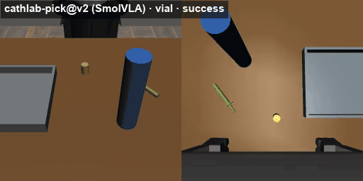 | 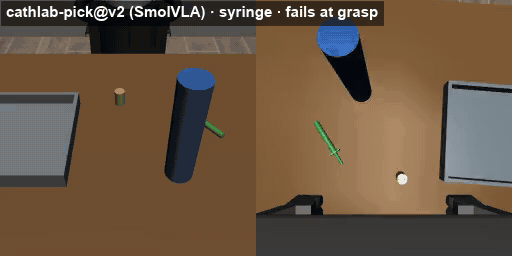 |

Left half: agentview, right half: wrist camera. All nine recorded rollouts (3 engines × 3 objects) are listed in
[configs/demo_videos.yaml](configs/demo_videos.yaml) (ASSIST → RECORDED ROLLOUTS in the Control Station).

## Control Station

The Control Station (`make dev`) drives the whole loop from one UI; full reference in [docs/GUIDE.md](docs/GUIDE.md).

| | |
|---|---|
| 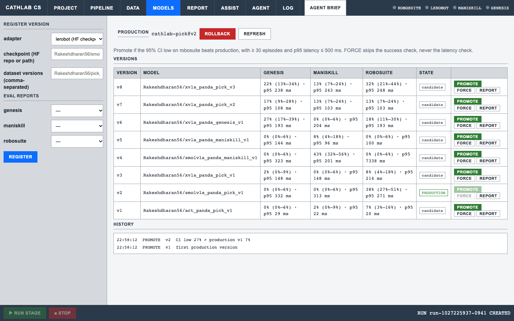 **MODELS:** register evaluated checkpoints as `cathlab-pick@vN`, promote by the CI rule, roll back. | 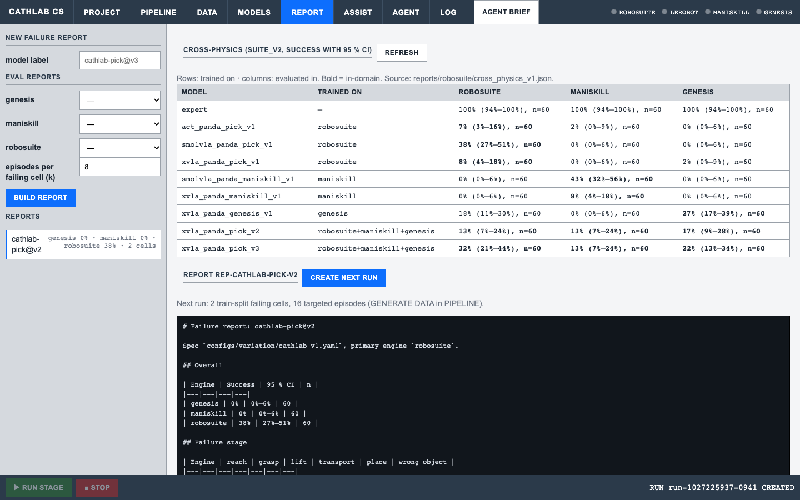 **REPORT:** cross-physics table, failure report (failing cells, sim2sim gap) → CREATE NEXT RUN. |
| 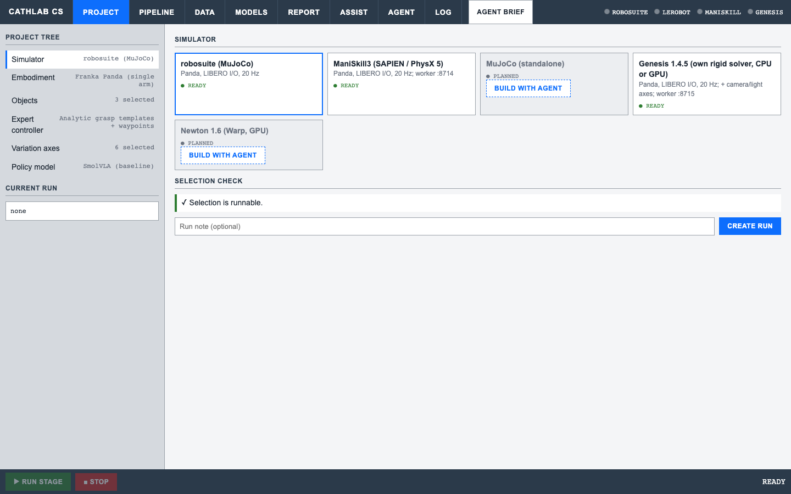 **PROJECT:** pick simulator, embodiment, objects, expert, variation and model; anything not ready offers **Build with agent**. | 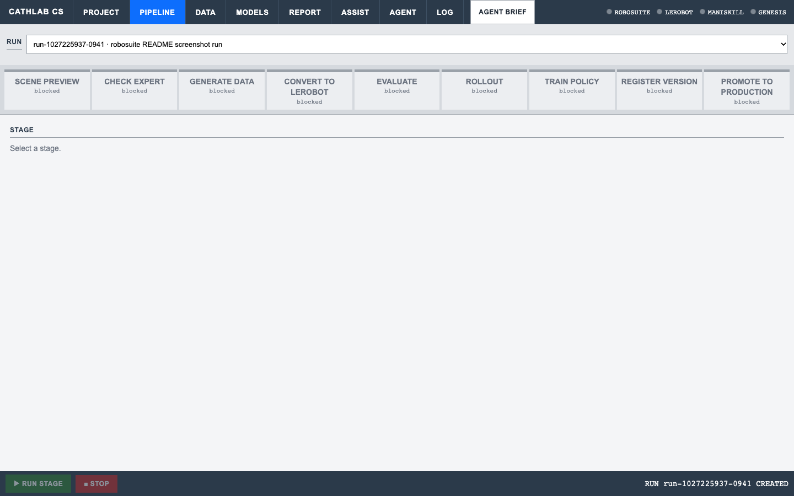 **PIPELINE:** preview → check expert → generate → convert → eval → rollout → train → register → promote, on workers. |
| 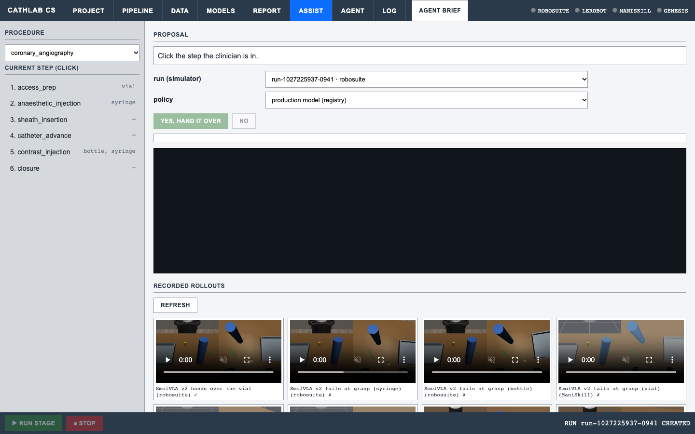 **ASSIST:** the procedure step proposes the object; YES hands it over with the production model. | 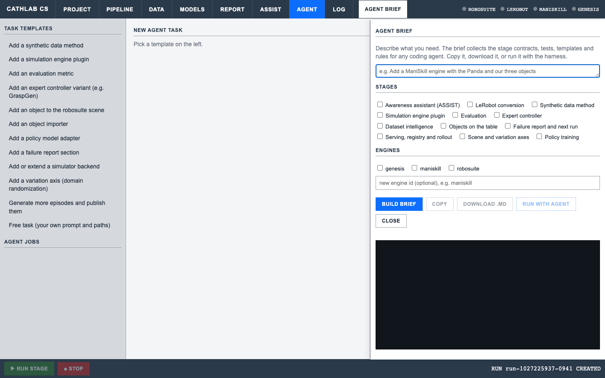 **AGENT / AGENT BRIEF:** run a task template with a coding agent in an isolated worktree, or get a deterministic brief ([docs/HARNESS.md](docs/HARNESS.md)). |

## Repository layout

| Path | What |
|---|---|
| `contracts/` | The only coupling between packages: `TaskSpec`, `DatasetManifest`, `PolicyAdapter`, `SimBackend`, `EvalReport`, `ModelCard` |
| `dataengine/` | Engine-agnostic sim core: variation specs, analytic expert, generators, npz/LeRobot sinks |
| `engines/`, `sim/` | Engine plugins (uniform 6-stage CLI) and their `SimBackend` / `ExpertSim` adapters |
| `ingest/`, `dataset_intel/` | Dataset contract checks, quality and readiness reports |
| `train/` | Training recipes (ACT, SmolVLA, X-VLA), LeRobot adapter, model cards, cross-physics report |
| `eval/`, `report/` | Metrics, VLM judge, failure analysis; failure report + targeted `next_run.json` |
| `serve/` | Model registry (versions, promotion rule, rollback), policy server and client |
| `orchestrator/`, `frontend/` | Control plane (FastAPI), workers, pipeline stages, loop API; the Control Station UI |
| `harness/` | Agent harness: stage gates, task templates, worktrees, briefs |
| `awareness/` | Procedure model + step tracking for ASSIST |

## Datasets

From [configs/datasets.yaml](configs/datasets.yaml) (the DATA tab's source):

| Dataset | Robot / I/O | Engine (physics) | Episodes | Frames | FPS | Link |
|---|---|---|---|---|---|---|
| `pick_robosuite@v1` | Panda, `panda_libero` | robosuite (MuJoCo 3.3.7) | 384 | 69,191 | 20 | [HF](https://huggingface.co/datasets/Rakeshdharan56/pick_robosuite) |
| `pick_maniskill@v1` | Panda, `panda_libero` | ManiSkill3 (PhysX 5) | 369 | 45,387 | 20 | [HF](https://huggingface.co/datasets/Rakeshdharan56/pick_maniskill) |
| `pick_genesis@v1` | Panda, `panda_libero` | Genesis 1.4.5 | 383 | 66,447 | 20 | [HF](https://huggingface.co/datasets/Rakeshdharan56/pick_genesis) |
| `pick_panda_v2@v1` | Panda, `panda_libero` | robosuite + ManiSkill + Genesis (merged) | 1,136 | 181,025 | 20 | [HF](https://huggingface.co/datasets/Rakeshdharan56/pick_panda_v2) |
| `cathlab_fr3_newton_v1@v1.0.1` | FR3 Duo, `fr3_duo_16d` | Newton 1.6 (MuJoCo-Warp) | 384 | 159,568 | 30 | [HF](https://huggingface.co/datasets/aravindsuresh16/cathlab_fr3_newton_v1) |

Details, conventions and how to use them: [docs/data.md](docs/data.md).

Episodes from each `v1` dataset (agentview | wrist camera, 2× speed; three instructions per GIF):

| robosuite (MuJoCo) | ManiSkill3 (PhysX 5) | Genesis |
|---|---|---|
| 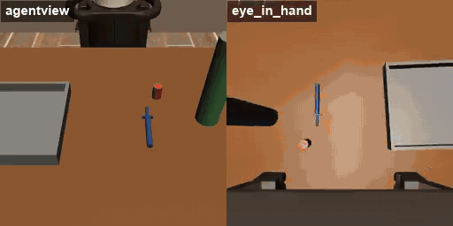 | 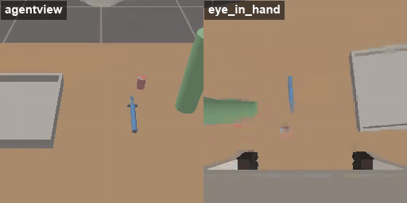 | 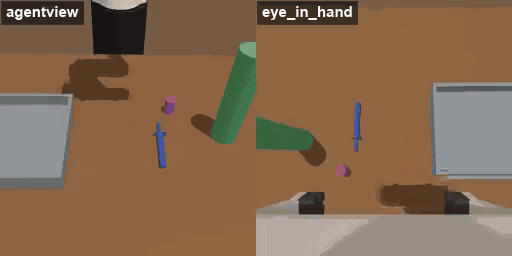 |

## Models / checkpoints

Trained with `train/recipes/{act,smolvla,xvla}.yaml` (see [configs/demo_videos.yaml](configs/demo_videos.yaml) and
`scripts/demo_bootstrap.py`'s `CHECKPOINTS` for the exact training order):

| Checkpoint | Trained on | Link |
|---|---|---|
| `act_panda_pick_v1` | `pick_robosuite@v1` | [HF](https://huggingface.co/Rakeshdharan56/act_panda_pick_v1) |
| `smolvla_panda_pick_v1` (production, `cathlab-pick@v2`) | `pick_robosuite@v1` | [HF](https://huggingface.co/Rakeshdharan56/smolvla_panda_pick_v1) |
| `xvla_panda_pick_v1` | `pick_robosuite@v1` | [HF](https://huggingface.co/Rakeshdharan56/xvla_panda_pick_v1) |
| `smolvla_panda_maniskill_v1` | `pick_maniskill@v1` | [HF](https://huggingface.co/Rakeshdharan56/smolvla_panda_maniskill_v1) |
| `xvla_panda_maniskill_v1` | `pick_maniskill@v1` | [HF](https://huggingface.co/Rakeshdharan56/xvla_panda_maniskill_v1) |
| `xvla_panda_genesis_v1` | `pick_genesis@v1` | [HF](https://huggingface.co/Rakeshdharan56/xvla_panda_genesis_v1) |
| `xvla_panda_pick_v2` | `pick_panda_v2` (robosuite + ManiSkill + Genesis) | [HF](https://huggingface.co/Rakeshdharan56/xvla_panda_pick_v2) |
| `xvla_panda_pick_v3` (loop retrain) | `pick_panda_v2` + 48 targeted episodes from `cathlab-pick@v2`'s `next_run.json` | [HF](https://huggingface.co/Rakeshdharan56/xvla_panda_pick_v3) |

## Engines

| Engine | Robot | Physics | Plugin |
|---|---|---|---|
| robosuite | Panda | MuJoCo 3.3.7 | `engines/robosuite` |
| ManiSkill3 | Panda | PhysX 5 | `engines/maniskill` |
| Genesis | Panda | Genesis 1.4.5 (own rigid solver) | `engines/genesis` |
| Newton | FR3 Duo | MuJoCo-Warp | [Aravind's repo](https://github.com/aravinds1610/mujoco_cathlab_vla) (not a plugin here) |

## Docs

| Doc | What |
|---|---|
| [docs/GUIDE.md](docs/GUIDE.md) | Control Station user guide: every tab, button and pipeline stage, troubleshooting |
| [docs/DEMO.md](docs/DEMO.md) | 5-minute Control Station demo walk-through, with fallbacks |
| [docs/INSTALL.md](docs/INSTALL.md) | Native and remote-GPU-worker install |
| [docs/HARNESS.md](docs/HARNESS.md) | Agent harness: task templates, worktrees, stage gates, briefs |
| [docs/EXTENDING.md](docs/EXTENDING.md) | How the platform fits together and how to add an engine, object, data method, metric or report section |
| [docs/data.md](docs/data.md) | Datasets: provided + generated, formats, access, data-quality rules |
| [engines/README.md](engines/README.md) | Engine plugin contract (manifest, uniform CLI, stages) |
| [AGENTS.md](AGENTS.md) | Rules for coding agents (and humans) working in this repo |
| [CREDITS.md](CREDITS.md) | Third-party projects, models and papers this builds on |
| [docs/Home.md](docs/Home.md) | Knowledge-base index (Obsidian vault entry note) |

The repo is also an [Obsidian](https://obsidian.md) vault: open the repo root as a vault and start at
[docs/Home.md](docs/Home.md).

## Origin

Built for the Siemens Healthineers Hackathon 2026 (Challenge C2). Planning history (specs, plans, handoffs,
status, decisions) lives on the `pre-dev` branch.
